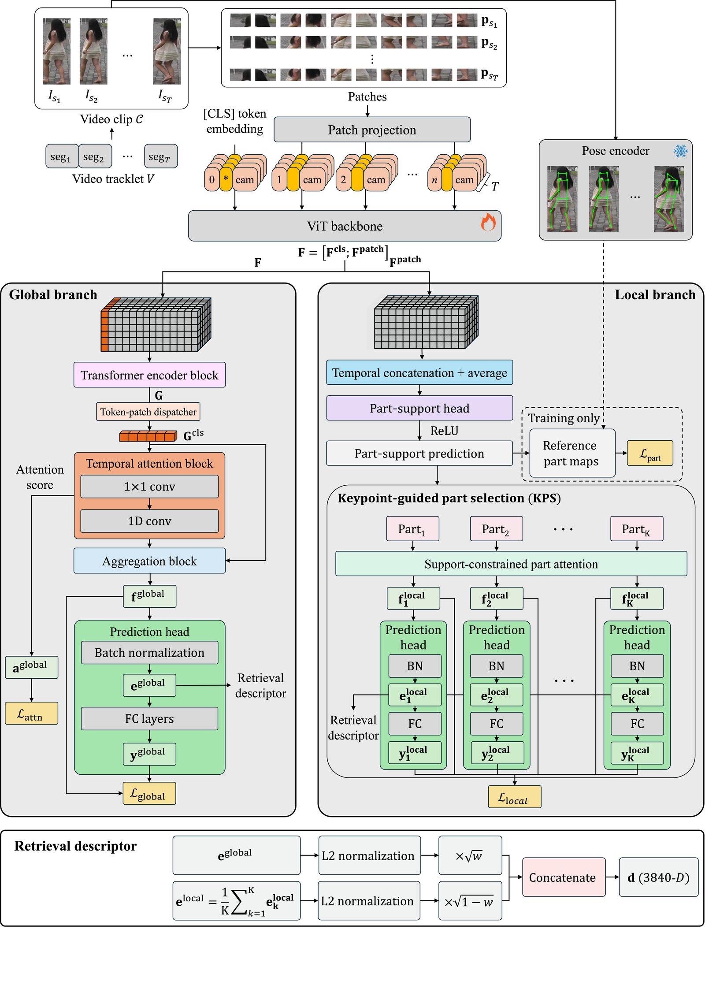
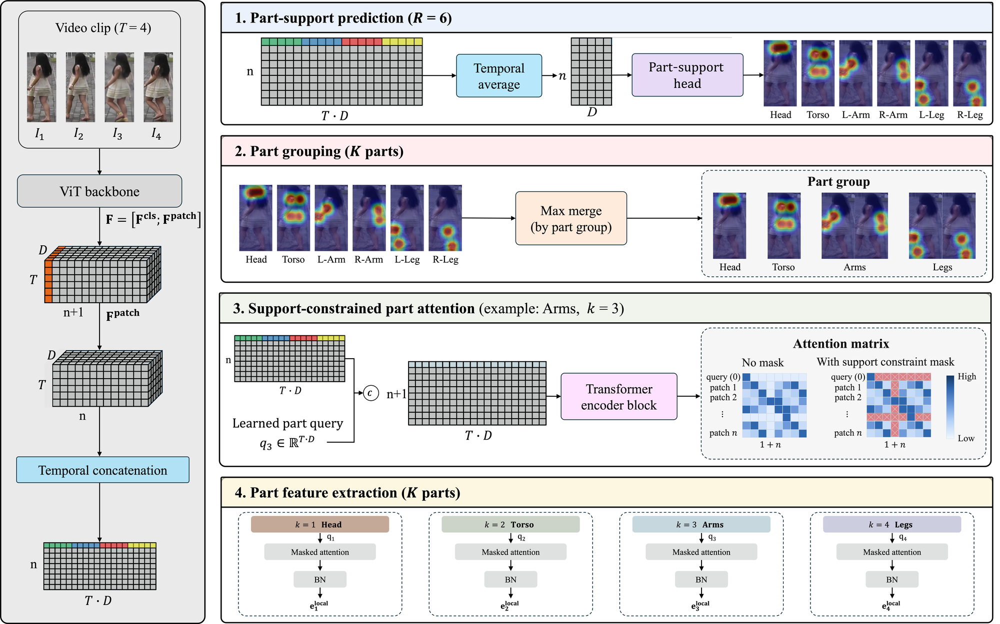

# KeyRe-ID: Keypoint-Guided Person Re-Identification using Part-Aware Representation in Videos

Official PyTorch implementation of **KeyRe-ID: Keypoint-guided person re-identification using part-aware representation in videos**.

## Overview

KeyRe-ID is a keypoint-guided Transformer framework for video-based person re-identification that pairs a **global identity branch** with a **pose-adaptive local branch**. Pose, viewpoint and the detection box change where each body part falls inside the crop, so a part representation built on a fixed spatial division carries different body content from one clip to the next. KeyRe-ID decides the spatial extent of each part in every clip.

<p align="center">
  
</p>

*Overall framework.* A video tracklet is divided into *T* segments and one frame is sampled from each to form a clip. The frames are embedded as patch tokens together with a `[CLS]` token and a camera embedding and encoded by a shared ViT backbone, whose output **F** = [**F**<sup>cls</sup>; **F**<sup>patch</sup>] feeds two branches. The global branch aggregates the `[CLS]` tokens over time; the local branch predicts part supports from the patch tokens and reads *K* part features through KPS. The frozen pose encoder supplies reference part maps during training only. At retrieval, the global embedding and the averaged part embedding are each L2-normalized, weighted and concatenated into a 3,840-d descriptor.

- **Global branch.** Frame-level `[CLS]` tokens are aggregated through temporal attention into a holistic clip-level descriptor.
- **Keypoint-guided Part Selection (KPS).** Each body part is read by a learnable query whose attention is restricted to a spatial support the network predicts for every clip, not to a fixed image stripe.
  - An internal part-support predictor (layer normalization + one linear layer, 6.2K parameters) predicts, for every patch, its support for six anatomical regions, which are merged into *K* = 4 parts (head, torso, arms, legs).
  - It selects which patches a query may read rather than weighting them: each part query uses a binary attention mask defined by its positive support.
  - It is supervised by a region-overlap (soft Dice) objective against part maps rendered offline by an off-the-shelf pose estimator, so part semantics follow the body under pose and viewpoint change. **No pose estimator runs at inference.**
  - The patch descriptors carry each location's temporal trajectory, so a part descriptor is formed over the whole clip in one attention step.

<p align="center">
  
</p>

*Keypoint-guided Part Selection (KPS).* The patch tokens of the *T* frames are concatenated along the channel axis, so each of the *n* patch descriptors (dimension *T·D*) holds the trajectory of one location across the clip.
1. **Part-support prediction.** The temporally averaged patch tokens pass through the part-support head, which predicts a support map for each of the *R* = 6 anatomical regions (head, torso, left/right arm, left/right leg).
2. **Part grouping.** The region supports are max-merged into *K* part groups (head, torso, arms, legs for *K* = 4).
3. **Support-constrained part attention.** A learned query *q<sub>k</sub>* for each part attends over the patch descriptors in a Transformer encoder block; the mask lets the query read only the patches inside the predicted support of its part.
4. **Part feature extraction.** Each part query produces a part feature, and batch normalization gives the part embedding *e<sub>k</sub>*<sup>local</sup>.
- **Retrieval descriptor.** The *K* part embeddings are averaged; the part block and the global block are each L2-normalized and concatenated with equal weight, giving a **3,840-dimensional** descriptor, 3.4 times smaller than concatenating all blocks.

## Results

Mean ± standard deviation over three seeds (1234 / 5678 / 9012), obtained with the released weights and `tools/test.py`.

| Dataset | mAP | Rank-1 |
|---|---|---|
| MARS | 93.01 ± 0.21 | 98.28 ± 0.12 |
| DukeMTMC-VideoReID | 97.16 ± 0.06 | 100.00 ± 0.00 |
| iLIDS-VID | 96.84 ± 0.61 | 94.44 ± 1.02 |
| PRID-2011 | – | 97.38 ± 0.65 |

Model size: 219.2M parameters, 104.3 GFLOPs per 4-frame clip (256×128).

## Installation

```bash
conda create -n keyreid python=3.9 -y
conda activate keyreid
pip install torch==2.1.2 torchvision==0.16.2 --index-url https://download.pytorch.org/whl/cu118
pip install -r requirements.txt
```

Keypoints are only needed for training. They are extracted with OpenPifPaf in a separate environment:

```bash
conda create -n pose python=3.9 -y
conda activate pose
pip install torch==1.13.1 torchvision==0.14.1 openpifpaf==0.13.11
```

## Data preparation

Datasets: [MARS](http://www.liangzheng.com.cn/Project/project_mars.html), [DukeMTMC-VideoReID](https://github.com/Yu-Wu/DukeMTMC-VideoReID), [iLIDS-VID](https://xiatian-zhu.github.io/downloads_qmul_iLIDS-VID_ReID_dataset.html), [PRID-2011](https://www.tugraz.at/institute/icg/research/team-bischof/learning-recognition-surveillance/downloads/prid11/).

```
MARS/                      DukeMTMC-VideoReID/       iLIDS-VID/                       PRID-2011/
├── bbox_train/            ├── train/                ├── sequences/{cam1,cam2}/       ├── multi_shot/{cam_a,cam_b}/
├── bbox_test/             ├── query/                ├── train-test people splits/    └── splits.json
└── info/                  └── gallery/              └── splits.json
```

- Copy `splits/MARS/info/` into the MARS root, and `splits/iLIDS-VID/splits.json` and `splits/PRID-2011/splits.json` into the iLIDS-VID and PRID-2011 roots.
- **Keypoints (training only).** Run once per dataset; the `.pose` files mirror the image tree:

```bash
conda activate pose
python tools/extract_keypoints.py --data_root /path/to/MARS --output_dir /path/to/MARS_keypoints
```

The reference part maps are rendered from these files on the fly during training.

## Pretrained weights

Download `KeyRe-ID_weights.zip` from [Google Drive](https://drive.google.com/drive/folders/12uYQ-2m7Yz60Kjxc0GlNp-QN5F_TGCKB) and unzip it in the repository root (`unzip KeyRe-ID_weights.zip`):

```
weights/
├── MARS/keyreid_mars_seed{1234,5678,9012}.pth
├── DukeMTMC-VideoReID/keyreid_duke_seed{1234,5678,9012}.pth
├── iLIDS-VID/keyreid_ilids_seed{1234,5678,9012}.pth
└── PRID-2011/keyreid_prid_seed{1234,5678,9012}.pth
```

For training, download the ImageNet-21K ViT-B/16 weights from [timm](https://github.com/rwightman/pytorch-image-models/releases/download/v0.1-vitjx/jx_vit_base_p16_224-80ecf9dd.pth) to `weights/pretrained/jx_vit_base_p16_224-80ecf9dd.pth`.

## Evaluation

```bash
python tools/test.py --dataset MARS --data_root /path/to/MARS \
    --weights weights/MARS/keyreid_mars_seed1234.pth
```

`--dataset` is one of `MARS`, `DukeMTMC-VideoReID`, `iLIDS-VID`, `PRID-2011`. `scripts/eval_all.sh` evaluates every released checkpoint.

At inference each tracklet is cut into consecutive non-overlapping 4-frame clips, the last one padded by repeating its own frames. The clip embeddings are averaged, and tracklets are ranked by the Euclidean distance between their 3,840-d descriptors (Eq. 17 of the paper).

## Training

**MARS and DukeMTMC-VideoReID** (from ImageNet-21K ViT-B/16, 120 epochs):

```bash
python tools/train.py --dataset MARS --data_root /path/to/MARS \
    --keypoint_root /path/to/MARS_keypoints --output_dir outputs/mars_seed1234 --seed 1234
```

**iLIDS-VID and PRID-2011** (fine-tuned from the MARS model with the best Rank-1, `best_rank1.pth`, saved by `tools/train.py`):

```bash
python tools/finetune.py --dataset iLIDS-VID --data_root /path/to/iLIDS-VID \
    --keypoint_root /path/to/iLIDS-VID_keypoints --init outputs/mars_seed1234/best_rank1.pth \
    --output_dir outputs/ilids_seed1234 --seed 1234
```

`scripts/train_mars_duke.sh` and `scripts/finetune_small.sh` run all three seeds.

### Main settings

| | |
|---|---|
| Backbone | ViT-B/16, patch 16, stride 16, ImageNet-21K |
| Input | 4-frame clips, 256×128, horizontal flip, random erasing |
| Optimiser | SGD, lr 0.008, momentum 0.9, weight decay 1e-4, batch 16×4 frames, cosine schedule with 5 warm-up epochs, FP16 |
| Parts | *K* = 4 (head, torso, arms, legs) from six predicted regions; `--num_parts 3` (head, torso + arms, legs) and `--num_parts 6` (one part per region) are also supported |
| Reference part maps | OpenPifPaf v0.13.11 (ShuffleNetV2K16); Gaussian kernel 1/11 of the crop width; joints below confidence 0.1 discarded; training only |
| Loss weights | α = 0.875 (global / part), β = 0.0005 (center), γ = 5.0 (Dice), camera embedding λ = 3.0 |
| Descriptor | 3,840-d, equal weight (w = 0.5) |

## Repository structure

```
keyreid/
├── backbone.py            ViT-B/16 with camera embedding
├── model.py               KeyRe-ID: global branch, KPS (part-support predictor, restricted part readout)
├── losses.py              identity / triplet / center losses
├── evaluation.py          descriptor, CMC and mAP
├── solver.py              optimiser and learning-rate schedule
└── data/
    ├── datasets/          MARS, DukeMTMC-VideoReID, iLIDS-VID, PRID-2011
    ├── reference_maps.py  keypoints -> reference part maps (six regions)
    └── video.py           clip sampling, augmentation, identity sampler
tools/
├── train.py               MARS / DukeMTMC-VideoReID
├── finetune.py            iLIDS-VID / PRID-2011
├── test.py                evaluation
└── extract_keypoints.py   OpenPifPaf keypoint extraction
```

## Acknowledgements

This code builds on [VID-Trans-ReID](https://github.com/AishahAADU/VID-Trans-ReID), [TransReID](https://github.com/damo-cv/TransReID) and [OpenPifPaf](https://github.com/openpifpaf/openpifpaf).

## Citation

```bibtex
@article{kim2025keyreid,
  title   = {KeyRe-ID: Keypoint-Guided Person Re-Identification using Part-Aware Representation in Videos},
  author  = {Jinseong Kim and Jeonghoon Song and Gyeongseon Baek and Byeongjoon Noh},
  journal = {arXiv preprint arXiv:2507.07393},
  year    = {2025}
}
```

## License

This project is released under the MIT License.
